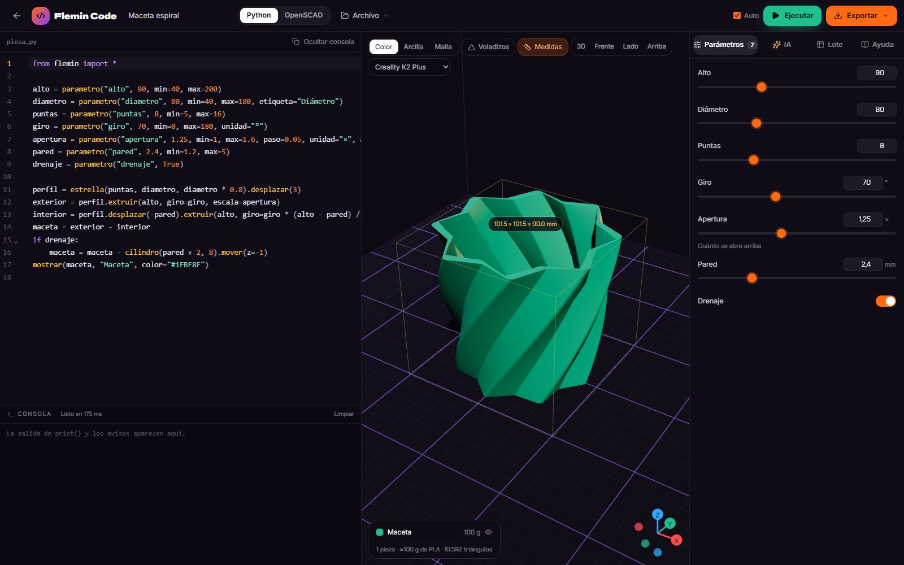
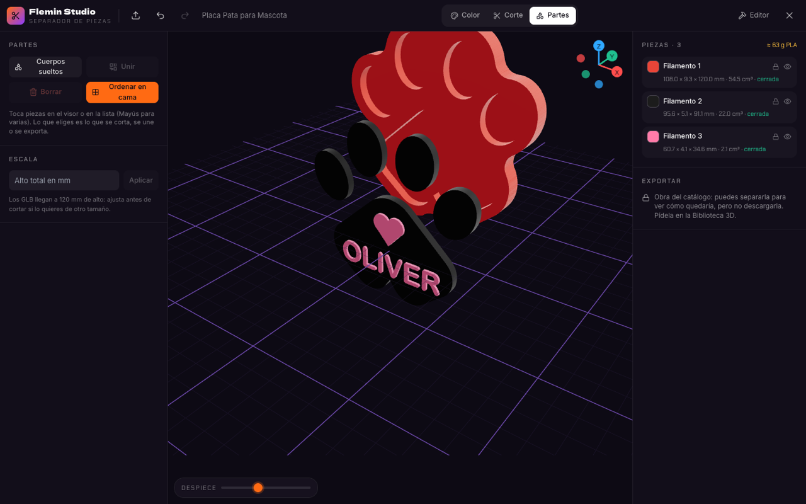
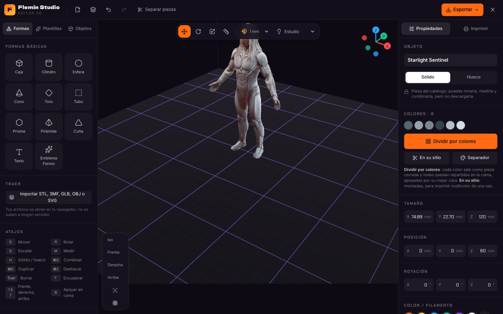

 

### Tu modelo 3D, en piezas perfectas para imprimir. En un clic.

---

## ✦ Qué es

**Flemin Studio 3D** es un motor de separación para impresión 3D que corre entero en tu navegador. Abres un modelo — un 3MF pintado en Bambu u Orca, un GLB de **Meshy** con textura, un STL — y en segundos lo tienes partido en **piezas cerradas, ordenadas en la cama y listas para el laminador**.

Sin instalar nada. Sin cuentas. **Tus archivos nunca salen de tu computadora.**

  

## ✦ Nuevo: Flemin Code

**Diseña piezas con código, o pídeselas a la IA.** Python (con la biblioteca `flemin`) u OpenSCAD, en el navegador y sin instalar nada. Describe la pieza en español y la IA escribe el código, lo ejecuta y lo corrige sola; cada medida sale como un control para ajustarla al instante. Una tabla de Excel genera lotes (50 nombres, 50 llaveros) y todo sale en **3MF multicolor**, STL o directo al Editor y al Separador.

  

## ✦ Lo que hace

<table>
<tr>
<td width="50%" valign="top">

### 🎨 Divide por colores, de un clic
Cada color sale como pieza **cerrada**. El motor limpia las motas de la textura, endereza los bordes y vuelve a trazar las fronteras como curvas: el corte sigue tu diseño, no la escalera de triángulos.

</td>
<td width="50%" valign="top">

### 🧩 Incrusta en vez de partir
Ojos, logos y detalles como **placas de la profundidad que elijas** metidas en el cuerpo, con su hueco exacto. El color no atraviesa la figura.

</td>
</tr>
<tr>
<td valign="top">

### ✂️ Cortes con conectores
El **plano sigue a tu mouse** sobre el modelo y un clic lo fija, o toma la orientación de la cara que tocas. **Espigas** redondas, cuadradas o triangulares, o **clavijas sueltas**, con la holgura de tu impresora, colocadas solas en el punto más firme del corte.

</td>
<td valign="top">

### ✏️ Separa la forma que quieras
**Marca una zona** pasando el mouse con el pincel, con un relleno que se detiene en las aristas, o con un **contorno pegado a la superficie**: clics alrededor y la línea sigue la malla. Lo marcado sale como pieza cerrada. También hay corte con boceto sobre la vista.

</td>
</tr>
<tr>
<td valign="top">

### 📐 Ordenadas en tu cama
Al separar, las piezas se **acomodan solas sobre la cama** de tu **Creality K2 Plus** o **SPARKX i7**: apoyadas por su mejor cara, en filas y centradas. Un clic las muestra montadas. ¿No cabe? Lo divide solo.

</td>
<td valign="top">

### 🛠️ Repara lo que otros entregan roto
Mallas abiertas de Meshy o escaneos, agujeros y aristas rotas: se cierran antes de cortar. Botones de un clic para **reparar, aligerar mallas pesadas, borrar motas y aislar piezas**, y un control de calidad que comprueba que las piezas suman el volumen exacto del original.

</td>
</tr>
</table>

## ✦ Míralo trabajar

**Separado por colores y ordenado en la cama, automático**

  

**Modelos de Meshy con su textura, listos para dividir**

## ✦ Probado con archivos reales

| Archivo | Colores | Resultado |
|---|:---:|---|
| 3MF multicolor de Bambu Studio (aretes) | 5 | **5 piezas cerradas**, volumen exacto, 0,4 s |
| 3MF de 367 000 triángulos | 2 | **2 piezas cerradas**, 2 s |
| GLB con textura de Meshy | 5–8 | **todas cerradas**, ~5 s |
| 3MF de otra herramienta con 6 piezas abiertas | 8 | **8 de 8 cerradas** tras la reparación |

## ✦ Úsalo

1. Abre **[Flemin Studio 3D](https://flemin-studio-3d.analista-datos-pro.workers.dev/)**.
2. Arrastra tu **3MF, STL, GLB u OBJ**. Si trae colores, se separa solo.
3. Corta, divide para tu cama u ordénalo, y descarga el **3MF multicolor**, el **3MF en la cama** o **un STL por pieza**.

> También se abre desde la **[Biblioteca 3D de Flemin](https://fleremiasflemin20-maker.github.io/biblioteca-3d/)**: cada obra tiene su botón para verla separada.

## ✦ Ingeniería

- **Manifold** (el núcleo CSG de Blender y OpenSCAD) compilado a WebAssembly, en un worker: la interfaz nunca se congela.
- Geometría robusta: barridos direccionales por parches para incrustar, isolíneas suavizadas para las fronteras, membranas de superficie mínima para tapar cortes curvos.
- Contorno sobre la superficie con caminos geodésicos (Dijkstra sobre la malla) y control de conservación de volumen en cada separación.
- 60 pruebas automáticas con Manifold real y archivos 3MF multicolor reales.

---

© 2026 <b>Flemin</b> · Quito, Ecuador · Código propietario. Esta página publica solo la web del Studio.

